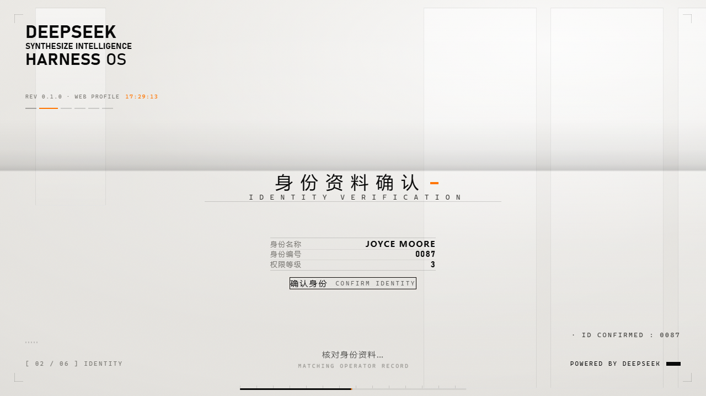
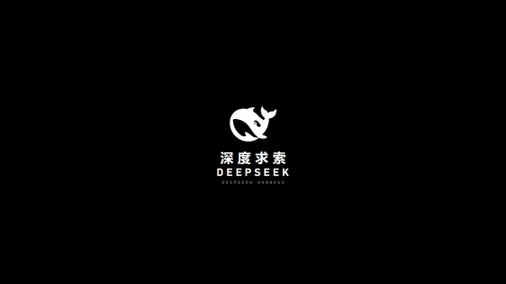

# dsh-boot-suite

> **DeepSeek Harness 开机套件** —— 六幕开机动画 + 聊天壁纸。
> 一个插件，两个半侧：**冷启动的仪式感**，和**进入聊天后的那张底图**。
> v2.2.0 起**分幕是数据**：可以换成任意幕数（1~24）的模板。

> 演示 GIF 由 `preview/demo.html` 逐帧录制，5 秒循环。真实播放带真声台词与界面音效。

---

## 它是什么

DeepSeek Harness（DSH）冷启动时会先播六幕动画，播完进聊天，再落在你自己设的底图上：

    黑幕 DeepSeek 标识 → 过曝洗白 → 暖白「技术档案」底板
      → 五步交互式访问授权 → 色散故障揭幕 → 聊天壁纸

**不是视频文件，是代码动画**：`lib/splash.js`（3288 行）+ `lib/splash.css`（1410 行），源码合计约 196 KB。
用 DOM + CSS 动画 + WebAudio 现场绘制，没有图片序列帧或视频素材。

| | 开机动画 | 聊天壁纸 |
|---|---|---|
| 入口 | DSH 设置页 →「启动动画」 | DSH 设置页 →「聊天背景」 |
| 内容 | 六幕序列、逐字打出的英文副标题、环形准星、色散故障 | 静态底图 / 大字横幅 |
| 素材 | 5 句真声台词 + 终幕欢迎语 + 2 个界面音效（mp3） | 插件自带默认底图 + 你自己的图片 |
| 可调 | 34 项：身份名称 / 编号 / 权限等级 / 配色 / 速度 / 音色 / 语速 / 每处文案 | 默认/自选底图、循环视频、纱的浓度、横幅文字、丢图即换 |

两个半侧**各自独立**：动画坏了不影响壁纸，壁纸坏了不影响动画，界面照常进。

---

## 安装

### 在线一键安装（GitHub 直连，无需网盘）

打开 PowerShell，粘贴这一行：

~~~powershell
irm https://raw.githubusercontent.com/LeeRolling/dsh-boot-suite/main/install-online.ps1 | iex
~~~

或者直接下载最新版压缩包：

https://github.com/LeeRolling/dsh-boot-suite/releases/latest/download/dsh-boot-suite-win.zip

> 安装前请完全退出 DeepSeek Harness（窗口 + 托盘）。
> 安装脚本会自动处理旧版残留；出问题运行包里的「诊断.cmd」。

### 方式一：双击安装（推荐，不需要命令行）

1. 下载本仓库（Code → Download ZIP，或 `git clone`）并解压
2. **完全退出** DeepSeek Harness Desktop（任务管理器里确认没有 `DeepSeek Harness` 进程）
3. 双击根目录的 **`安装.cmd`**
4. 重新打开桌面端

脚本会自动找到 DSH 的命令行（它不在 PATH 里也没关系）、找到已初始化的 profile、
卸掉同名旧插件、以 `link:` 方式装好并修正 `bundles` 列表，最后自检。
只想看它要做什么、不动手：`powershell -File tools\install.ps1 -CheckOnly`

### 方式二：命令行

    # 桌面端：先完全退出 DeepSeek Harness Desktop
    dsh plugin --profile desktop add link:<仓库路径>

**桌面端必须先完全退出** —— 否则 profile 的 `package.json` 被进程锁着，装不进去。
（`dsh` 不在 PATH 里的话，桌面端自带的在 `%LOCALAPPDATA%\Programs\DeepSeek Harness\resources\runtime\cli\bin\dsh.cmd`）

> 从旧的两个插件（`dsh-startup-screen` / `dsh-chat-wallpaper`）迁过来的话，
> 先 `dsh plugin --profile desktop remove` 掉它们，再装本插件。

### 方式三：npm（v2.13.11 起）

插件已发布到 npm 公共仓库，包名 `dsh-boot-suite`（版本号与 GitHub Release 一致）：

- 桌面端：**设置 → 插件 → 添加插件**，输入 `dsh-boot-suite` 安装；
- 普通 dsh web：`dsh plugin add dsh-boot-suite`。

> npm 上的是标准插件包（含内置模板与素材），安装后同样在设置页看到「启动动画」「聊天背景」。
> 如果 npm 版本落后于最新 Release，以 Release 的一键安装包为准。

---

## 开机动画

| # | 中文主字 | 英文副标题 | 要操作吗 |
|---|---|---|---|
| 1 | 需要访问许可 | ACCESS PERMISSION REQUIRED | 点按钮 / Enter / 空格 |
| 2 | 身份资料确认 | IDENTITY VERIFICATION | 点按钮 / Enter / 空格 |
| 3 | 接收访问需求 | ACCESS REQUEST RECEIVED | 自动 |
| 4 | 开始读取权限 | PERMISSION READ STARTED | 自动 |
| 5 | 读取完毕 · 核验通过 | READ COMPLETE · VERIFIED | 自动 |
| 6 | 欢迎「身份名称」访问 | WELCOME, NAME | 自动 |

- 中文主字 + 英文等宽副标题，**逐字打出**，像终端接收数据
- **真声台词**（`lib/assets/line-1..6.mp3`），素材缺失自动回落系统 TTS
- **配音音色可选** —— 内置 6 套完整配音（英文音色F（默认）+ 日文音色1–5），每套 6 句；另可叠 AI 机械音 / 机器人 / 无线电 / 老电视 / 低沉 5 种声音效果，或选「无」保留原声
- **语音没播完不推进** —— 每步停留时长由实际音频决定
- 显示模式：每次会话 / 总是 / 每天；可要求确认，也允许跳过

配置：`~/.dsh/dsh-startup.json`（设置页改，不用手改）

## 聊天壁纸

- **默认背景（v2.13.1）**：插件自带一张默认底图（就是开机动画第二幕的鲸鱼娘静帧），装好、打开聊天就有，不用先丢图；设置页「背景图」里第一张「默认背景（内置）」随时可点回来，也可以点「不用背景图」彻底关掉
- **静态底图**：丢进 `~/.dsh/chat-wallpaper/` 就自动换（按修改时间取最新）
- **大字横幅**：铺满窗口的一行字，矢量文字，字号按窗口自动算，浓度可调
- **纱的浓度**：盖在底图上的一层纱，深色 / 浅色主题各一套，字更清楚
- **镜头模糊（v2.13.11）**：纱下面可加背景模糊，强度 0–100 可调（0 完全不模糊，100 约 24px）；只模糊壁纸/视频，聊天文字保持清晰
- **文字明暗自适应（v2.13.9）**：聊天正文按「壁纸 + 纱叠完后的实际亮度」自动提亮 / 压深（暗底配白字、亮底配黑字，含行内代码/文件名；亮度取画面中间区域，加轻阴影兜底）；「纱的浓度」按 DSH 外观主题各存一套，浅色主题用浅色纱、深色主题用深色纱，拖滑块立即生效；左侧边栏、顶部标题栏只垫一层与 DSH 外观同深浅的半透明面板，文字/图标/按钮全部保持 DSH 原色；输入框完全交回 DSH 原生主题——不会再出现白底白字、白底白图标
- **窗口按钮固定高对比（v2.13.10）**：右上角最小化 / 最大化 / 关闭是 Windows 原生画在页面之上的，插件给它们固定一对「浅色外观=浅底深图标、深色外观=深底浅图标」的颜色，不再被半透明壁纸底色带成白底白图标；片头播放期间标题栏仍保持透明
- **只留在聊天里**：不和启动动画第二幕抢画面（v2.11.8 起开场视频已移除）；v2.13.0 新增可选的「循环视频」背景（默认关闭）
- **循环视频（v2.13.0）**：把 mp4/webm 或壁纸引擎项目文件夹放进 `~/.dsh/chat-wallpaper/loops/`（可添加自定义目录），设置页「聊天背景」→「循环视频」可选 静态底图/循环视频、手动/随机轮换；默认静音循环、只读本机；列表可删除（壁纸引擎项目整体删除）
- **色彩模式（v2.13.17）**：聊天背景可切「彩色（默认，不调色）/ 黑白（原版素材，不染色）」；黑白模式关掉主题色纱，画面保持原样

配置：`~/.dsh/chat-wallpaper.json`（设置页改）

---

## 模板（v2.2.0 起）

六幕不是写死的：**每一幕的文案、音频槽、按钮、停留时长都是数据**，幕数 1~24 任意。

    templates/<id>/template.json          # 插件自带
    ~/.dsh/startup-templates/<id>/template.json   # 你自己的（同 id 优先）

### 开机体验（v2.5.0）

- **不露底**：首帧在文档解析阶段就画上，DSH 自带的「HARNESS / Loading plugins…」卡片被按掉
- **标题栏收编**：桌面端片头播放时，右上角原生按钮条变透明，按钮浮在动画上（片头结束自动还回去）
- **两段式揭幕**：内容先化进自己的底色（200ms），底色再淡出（420ms）—— 不会把结尾 logo 留成灰影
- **检查更新**：设置页「启动动画」底部一键比对 GitHub 最新版本

选哪个模板：DSH 设置页「启动动画」→ 模板下拉框；或直接改 `~/.dsh/dsh-startup.json` 的 `template` 字段，留空 = 内置。

**模板商店**：设置页 →「打开模板编辑器」→ 顶栏「🏪 商店」。列表来自
[dsh-boot-suite-templates](https://github.com/LeeRolling/dsh-boot-suite-templates) 的 `index.json`，
点「安装」即落到 `~/.dsh/startup-templates/<id>/`。不建服务器、不需要登录。
格式见 [docs/模板格式.md](docs/模板格式.md)。模板**只能是数据**，运行时不会执行模板里的任何代码。
找不到模板、字段缺了、id 非法 —— 一律回落内置，不会黑屏。

### 自定义动画与转场（v2.12.0）

- 设置页「启动动画」→「自定义动画」→「📥 导入动画」：选 mp4 / webm / gif / png / jpg / webp（≤64MB），自动生成用户模板（存 `~/.dsh/startup-templates/`），之后「第一幕」「第二幕」下拉都能选它；视频自动读时长、静音铺满，图片 / GIF 默认 6 秒。
- 同一页「转场」组：**第一幕入场 / 第一幕 → 第二幕 / 第二幕 → 桌面** 三段可各选转场 —— 交叉叠化（默认）/ 闪白 / 故障 / 扫描线（方向可选）/ 推移 / 虹膜 / 黑场 / 硬切；时长 200–2000ms。
- 旧配置不用动：缺字段自动用默认（全部交叉叠化）；转场是纯配置数据，失败会自动回落，不会黑屏。
- 每一幕右侧的「删除该动画」：本地动画会删除文件（不可恢复）；内置模板只是隐藏（不删安装文件，模板组底部可一键恢复）；正在被引用的会自动切回默认。

---

## 更新保护：自动紧急回滚（v2.13.3）

- 每次安装/更新到新版本前，安装器会把「当前能用的版本」记成一个**桌面按钮**：`紧急回滚-V<当前版本>（先完全退出 DSH 再双击）.cmd`。新版装不上、或装完 DSH 打不开时，完全退出 DSH（窗口 + 托盘）后双击它，就会把插件切回更新前的版本 —— **只换插件版本，不动你的设置**。
- 新版安装成功、确认没有报错后，旧按钮会在下一次更新前被自动替换（不会越积越多），**不用手动删**；想自己删也行，它只是个 `.cmd`。
- 每次回滚都会在桌面写一份 `dsh-boot-suite 回滚日志 yyyyMMdd-HHmmss.txt`，真出问题时把这份日志发给作者。

---

## 出事了怎么救 🧯

这个插件注入的是**首屏**，出问题时是整块黑屏、连"跳过"都点不到。所以仓库自带三个**不依赖界面**的维护脚本：

| 工具 | 干什么 | 什么时候用 |
|---|---|---|
| **`卸载.cmd`**（根目录） | 等于 `tools/emergency-uninstall.cmd` | **开机黑屏、界面点不动**，只想先恢复 |
| `tools/emergency-uninstall.cmd` | 把插件从 profile 里彻底卸掉 | 同上，脚本本体 |
| `tools/rollback.cmd` | 切回 `backups/` 下最新的已知可用快照 | 想退回上一个能用的版本 |
| `tools/make-backup.ps1` | 给当前状态留快照 | **改代码之前** |

用法：任务管理器结束全部 `DeepSeek Harness` 进程 → 双击脚本 → 重开客户端。

诊断日志写在 `~/.dsh/boot-suite-diag.log`（首屏注入走了哪条通道、自愈有没有触发、壁纸半侧卡在哪一步）。

---

## 结构

    lib/
      index.js          宿主半：把两个半侧挂在同一个 cordis 插件上
      host-startup.js   开机动画宿主管：/dsh-startup/* 路由 + index.html 首屏注入
      host-wallpaper.js 壁纸宿主管：/chat-wallpaper/* 路由 + 底图/横幅配置与静态图片
      client.js         浏览器半：一个模块 id（dsh-boot-suite），内部两个 IIFE
      splash.js / splash.css / assets/    开机动画运行时与素材
    preview/
      index.html        交互式离线预览（带设置面板，直接浏览器打开）
      demo.html         纯净演示页（无面板，截图/录屏用）
    test/               13 套冒烟测试，零依赖
    tools/              急救 / 回滚 / 备份
    docs/               README 用的图

### 改代码前先读这三条

1. **模块 id 必须等于 bundle 行名**（`dsh-boot-suite`），四处要一致：client 的 loader id、package.json、cordis.patch.yml 的 id 和 name。
2. **首屏注入行是一次性的**：行表幂等 + 订阅互斥。重复注入 = 两个 `#dsh-startup-root` = 永久黑屏（真实事故，见 `02-文档/故障记录`）。
3. **注入外部脚本只能用 `script-src` 行**，不能用 `html` 行包 `<script>` —— 桌面端解释器按文本插入，脚本不会执行。

---

## 测试

    npm test

13 套冒烟测试、约 998 项断言，零运行时依赖、零测试框架。改 `lib/` 下任何文件都要重跑。

---

## 许可与致谢

MIT（只覆盖作者原创代码与文案）。

视觉风格参考自动画作品；音频素材取自第三方视频，权利归原权利人。
**未授权任何商业用途。**

原作者：**沈宏宏** · 合并、修复与维护：LeeRolling

模板（`archive-warm` / `deep-sonar` / 商店里的 `archive-ink`）的视觉与叙事基于沈宏宏的动画作品，
模板 JSON 里的 `author` 字段如实标注原作者，`adaptedBy` 标注改版者。
## 参考动画与致谢（原版都不是本项目所作）

本项目参考、学习、复刻了以下三个公开作品，版权均归原作者：

| # | 动画 | 原作者 | 地址 |
|---|---|---|---|
| 1 | **最早的启动动画**（第一幕参考，带空格/回车交互的那支） | **沈宏宏**（@6shenhonghong9） | https://github.com/6shenhonghong9/dsh-startup-screen |
| 2 | **鲸鱼娘「DeepSeek娘扫描睁眼」**（可选模板 `whale-girl-scan`，素材随包） | NativeDog1/dsh-boot-animation 内置片库（BSD-3-Clause；原作者上游未标注，待确认） | https://github.com/NativeDog1/dsh-boot-animation |
| 3 | **550C 启动动画**（学习复刻对象，对应 `550c-homage`） | @yannicksong0106 | https://github.com/yannicksong0106/dsh-550c-boot |

前两项只做**形式参考与工程复刻**；第 2 项「鲸鱼娘扫描睁眼」素材按上游 **BSD-3-Clause** 许可随可选模板提供。
如果你喜欢这些动画，请去原仓库给作者点 star。

以上作品版权归原作者所有。本项目只做**形式参考与工程复刻**，不复用其素材；
如果你喜欢这些动画，请去原仓库给作者点 star。
